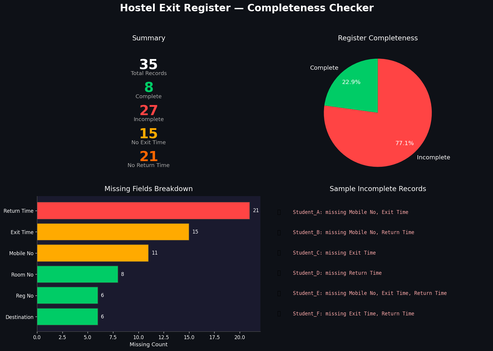
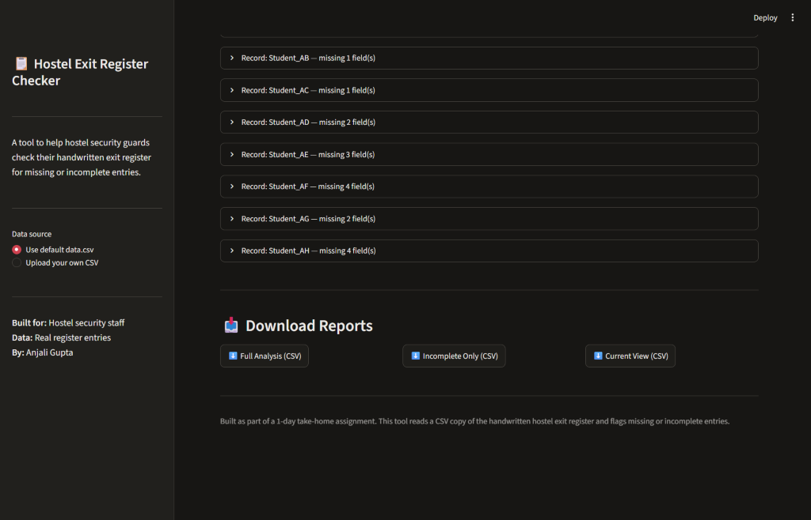

# Hostel Exit Register — Completeness Checker

A simple tool that checks a hostel's handwritten exit register for missing or incomplete entries. Built to help the hostel security guard catch gaps in the register before the warden asks for it.





## The Problem

My college hostel uses a handwritten paper register at the security gate. Every student leaving the hostel is supposed to fill in their name, room number, registration number, destination, phone number, and exit time. The guard notes the return time when students come back.

In practice:
- Students rush and skip fields (especially phone number and destination)
- Return times are often not recorded (students walk past without signing back in)
- The guard has no easy way to check which entries are incomplete
- When the warden asks for the register, missing data cannot be recovered

**Person helped:** The hostel security guard at the main gate  
**Location:** Hostel security counter  
**Date:** 17 November 2026

## Features

- **Upload CSV** — load any CSV file with register data, or use the default `data.csv`
- **Missing field detection** — finds blank fields in each record
- **Summary dashboard** — shows total, complete, and incomplete record counts
- **Completeness percentage** — visual progress bar showing overall register quality
- **Missing field breakdown** — bar chart showing which fields are most commonly skipped
- **Search and filter** — filter by date, completeness status, or search by name/room/destination
- **Detailed view** — expandable cards for each incomplete record showing exactly what's missing
- **Downloadable reports** — export full analysis, incomplete records, or filtered view as CSV
- **Error handling** — handles empty files, wrong column names, and invalid data gracefully

## Tech Stack

- **Python 3.13**
- **Streamlit** — web dashboard
- **Pandas** — data processing

## Folder Structure

```
hostel-exit-register-checker/
├── app.py                  # Main Streamlit application
├── data.csv                # Real register data (35 entries, anonymized)
├── requirements.txt        # Python dependencies
├── README.md               # This file
├── research.md             # Problem research and existing solutions
├── fieldwork.md            # Field observations and register analysis
├── reflection.md           # Personal reflection (written without AI)
├── ai-chats/               # Exported AI conversation logs
│   ├── chat-export.md
│   └── full-conversation.md
├── evidence/               # Fieldwork photos (privacy-redacted)
│   ├── photo1_security_counter.jpg
│   └── photo2_exit_register.jpg
└── screenshots/            # App screenshots
    └── dashboard_overview.png
```

## Installation

```bash
# Clone the repository
git clone https://github.com/YOUR_USERNAME/hostel-exit-register-checker.git
cd hostel-exit-register-checker

# Install dependencies
pip install -r requirements.txt
```

## How to Run

```bash
streamlit run app.py
```

The app opens in your browser at `http://localhost:8501`.

- By default, it loads `data.csv` (the real register data).
- To check a different register, use the sidebar to upload your own CSV file.

## CSV Format

Your CSV must have these columns (in any order):

| Column | Description | Example |
|--------|-------------|---------|
| Date | Date of entry | 15/11/26 |
| Name | Student name | Student_A |
| Room_No | Room number | 3010 |
| Reg_No | Registration number | CE113 |
| Destination | Where the student went | Canteen |
| Mobile_No | Contact number | 9876543210 |
| Exit_Time | Time of leaving | 6:30 |
| Return_Time | Time of return | 8:45 |
| Remarks | Any additional notes | (optional) |

Blank fields are allowed — the tool will flag them as missing.

## Real Output

Running the tool on the actual register data (`data.csv` with 35 entries):

```
Total Records:    35
Complete:          8  (22.9%)
Incomplete:       27  (77.1%)
Missing Exit Time: 15  (42.9%)
Missing Return Time: 21  (60.0%)
```

**Most commonly missing fields:**
1. Return_Time — 21 entries (60%)
2. Exit_Time — 15 entries (43%)
3. Mobile_No — 11 entries (31%)
4. Room_No — 8 entries (23%)

This matches what we observed: students most often forget to record their return time, and the exit time is frequently skipped during early morning or late evening exits.

## Limitations

- **Cannot read handwriting directly.** The register data must be manually transcribed into CSV format first. The tool checks the digital copy, not the physical register.
- **Cannot verify accuracy.** The tool only checks if fields are filled, not whether the information is correct. A student could write a wrong phone number and the tool would not catch it.
- **OCR not included.** Automatic reading of the handwritten register was considered but not implemented — the handwriting quality varies too much for reliable OCR.
- **Single register format.** The tool expects the specific column format used in our hostel. Other hostels may use different column names.
- **No real-time tracking.** The tool works on a snapshot of the register (CSV export), not on live data.

## What This Tool Should NOT Be Trusted For

- Deciding whether a student is safe or in danger
- Replacing the physical register (the paper register is still the official record)
- Making security decisions (the guard's judgment matters more than any software)
- Verifying student identity or attendance

## Future Improvements

- Add OCR support to read the handwritten register directly from photos
- Build a simple mobile-friendly version the guard can use on a phone
- Add alerts when common patterns of missing data appear (e.g., all evening entries missing return times)
- Support multiple hostels with different register formats
- Add a date range selector for analysing trends over weeks

## Screen Recording

A 3-minute screen recording demonstrating the app is available here: [screen-recording.mp4](screen-recording.mp4)

The recording shows:
1. Starting the app and loading the default register data
2. Scrolling through the dashboard — metrics, charts, and colour-coded table
3. Filtering by date and completeness status
4. Expanding an incomplete record to see which fields are missing
5. Downloading the incomplete records report as CSV

> *Note: Record this using any screen recorder (OBS, Windows Game Bar, or Loom) before submitting.*

---

*Built as a 1-day take-home assignment. Data collected from the actual hostel exit register on 17 November 2026. All student names and phone numbers have been anonymized.*
