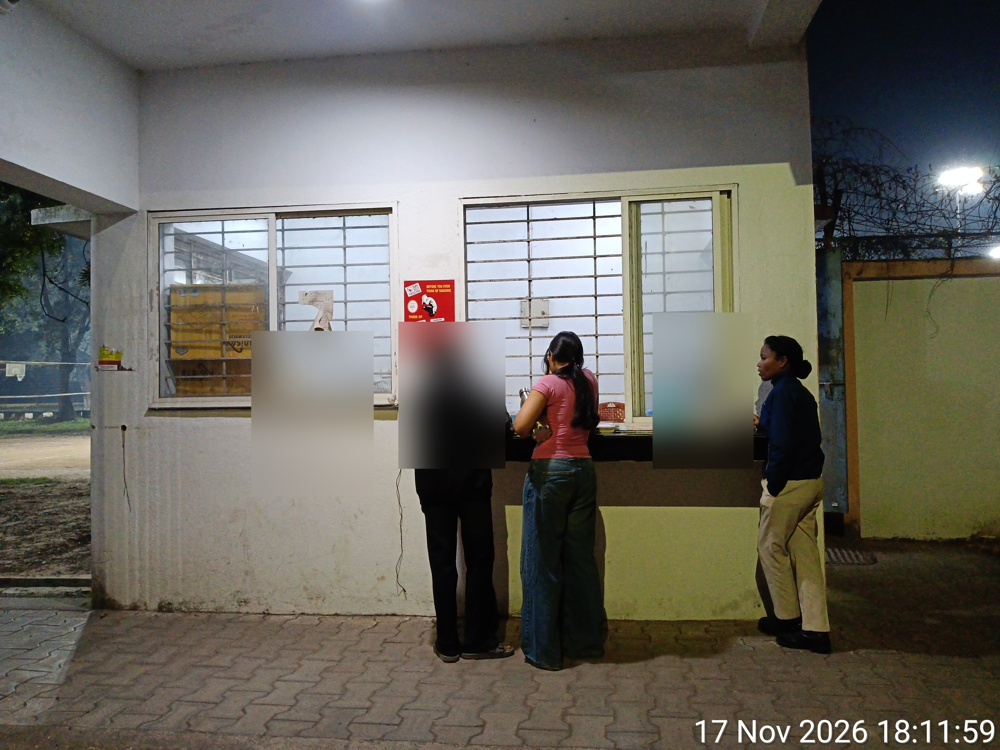
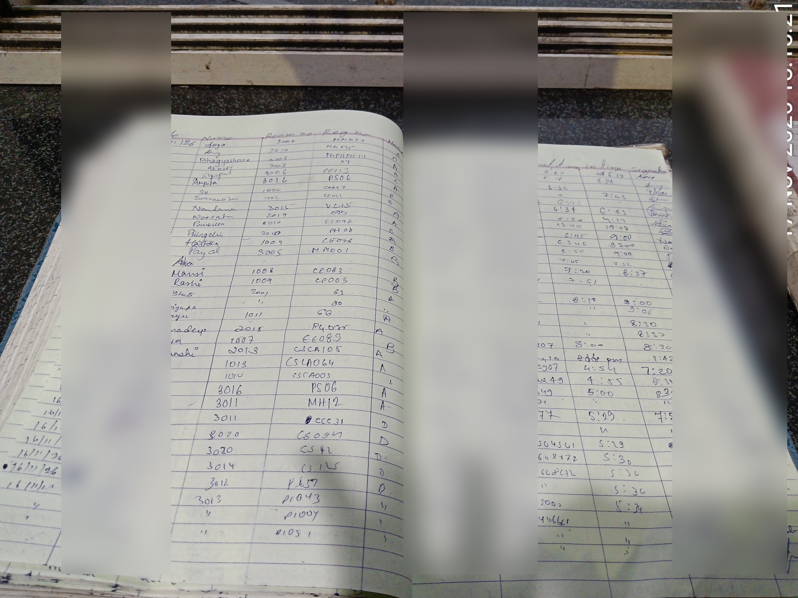

# Fieldwork: Hostel Exit Register Observation

## Location & Date

- **Place:** Hostel security gate / guard counter
- **Date:** 17 November 2026 (Tuesday)
- **Time of visit:** Approximately 6:10 PM – 6:30 PM
- **Evidence:** Two timestamped photographs taken at the location

## Photographs

### Photo 1 — Security Counter (18:11:59, 17 Nov 2026)

The photo shows the hostel security counter in the evening. Two students are standing at the counter filling the register, while a security guard stands nearby. The counter has the register book, a water bottle, and a notice board with hostel rules visible through the window. The area is lit by overhead lights, and the hostel gate and campus road are visible in the background.

### Photo 2 — Handwritten Exit Register (18:15:21, 17 Nov 2026)

The register is a large bound notebook lying open on the counter. It shows a two-page spread with entries from 15/11/2026 and 16/11/2026. The handwriting varies from entry to entry — some students write clearly, others are hard to read. Several fields are visibly blank.

## Register Structure

The register is a ruled notebook with the following columns spread across two pages:

| Left Page | Right Page |
|-----------|------------|
| Date | Destination (Place) |
| Name | Mobile Number |
| Room Number | Exit Time |
| Registration Number | Return Time |
| | Remarks / Signature |

## Observations About the Register

1. **Missing fields are common.** Many rows have blank spaces — especially the Return Time column (students forget to sign back in) and sometimes Destination or Mobile Number.
2. **Handwriting varies wildly.** Some entries are barely legible. The guard cannot always read what a student wrote.
3. **Date is not always filled.** Some students skip the date column, assuming it carries forward from the entry above.
4. **The register is physically large and heavy.** It stays on the counter. The guard cannot easily carry it to the warden's office to review.

## Data Collection

I photographed the open register and manually transcribed the entries into `data.csv`. The register showed entries from 15 November 2026 and 16 November 2026.

- **Total entries extracted:** 35
- **Method:** Read each row from the photograph, typed into a spreadsheet, then exported as CSV.
- **Anonymization:** All student names replaced with Student_A, Student_B, etc. Phone numbers partially masked (last 6 digits replaced with XXXXXX).
- **Blank fields preserved as-is** — if a field was empty in the register, it is empty in the CSV.
- **Uncertain readings noted:** Some entries were hard to read due to handwriting. I recorded my best reading but acknowledge some registration numbers or destinations may be slightly off.

See: [data.csv](data.csv)

## Conversation with the Security Guard

**Person:** Ramesh bhaiya (security guard)
**Role:** Hostel security guard, posted at the main gate

I spoke with Ramesh bhaiya while he was sitting at the counter during his evening shift. He has been working at this hostel gate for about three years. I told him I was making a small tool to help check the register, and asked him about the problems he faces.

### Three things the guard said:

1. **About missing fields:** "Sabse zyada problem phone number aur return time ka hota hai. Students jab bahar jaate hain toh jaldi mein hote hain — bas naam likh ke chale jaate hain. Raat ko wapas aate hain toh register tak aate hi nahi, seedha andar chale jaate hain." *(Translation: The biggest problem is with phone numbers and return times. Students are in a hurry when going out — they just write their name and leave. When they come back at night they don't come to the register, they go straight inside.)*

2. **About warden checks:** "Warden sir mahine mein ek-do baar register check karte hain. Agar koi field khaali hoti hai toh mujhe bolte hain — 'yeh kyun khaali hai?' Par main kya karun, student ne nahi likha toh main kaise bharun? Mujhe unka number ya room thodi pata hota hai." *(Translation: The warden checks the register once or twice a month. If any field is empty, he asks me — 'why is this blank?' But what can I do, if the student didn't write it, how can I fill it? I don't know their number or room.)*

3. **About student behaviour:** "Din mein toh theek hai, aaraam se likhte hain. Par shaam ko ya Sunday ko, 10-15 students ek saath aate hain — tab line lag jaati hai. Tab sabko jaldi hoti hai, isliye aadhe-adhoore bharte hain. Kabhi kabhi ek student likhta hai aur baaki bus jaate hain bina likhe." *(Translation: During the day it's fine, they write properly. But in the evening or on Sundays, 10-15 students come together — a queue forms. Everyone's in a rush, so they fill it half-heartedly. Sometimes one student writes and the rest just leave without writing.)*

### One thing that surprised me:

I assumed the register was mainly for hostel security — to know who is out and who is in. But Ramesh bhaiya told me that the register is actually checked most often after incidents, not during routine monitoring. He said, "Jab koi student late aata hai ya koi complaint hoti hai, tab warden register maangta hai. Tab dekhte hain ki kaun kab bahar gaya tha." *(When a student comes late or there's a complaint, then the warden asks for the register. That's when they check who went out when.)* So the register works more like a log that is read backwards — after something has already happened — not in real-time. This means incomplete entries are even more of a problem, because by the time someone looks at the register, the student is long gone and you can't ask them what they forgot to write.

---

*The conversation happened at approximately 6:15 PM on 17 November 2026 at the hostel gate counter. Ramesh bhaiya gave verbal permission to use his statements in this project report.*
